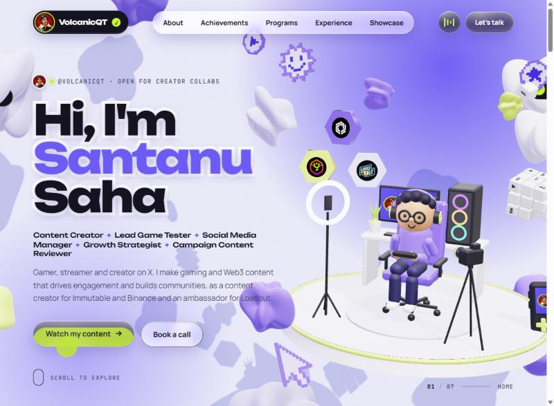

# VolcanicQT · 3D Portfolio

The portfolio of **Santanu Saha (VolcanicQT)**: full-time UGC and gaming content creator, Web3 creator-program member, social media manager and lead game tester.

**Live:** https://volcanicqt.vercel.app



## What's inside

| Folder | Contents |
|---|---|
| [`site/`](site) | The whole website: HTML, CSS, JavaScript, the Three.js 3D scene, and every image, logo, video and music file it uses |
| [`docs/`](docs) | **[Build guide (PDF)](docs/VolcanicQT-Portfolio-Build-Guide.pdf)**: languages, libraries, design system, every 3D object, animation timings, effects, media and deploy steps. Its HTML source and the screenshots are here too. |

## Built with

- **HTML, CSS, JavaScript (ES modules)**, no build step
- **[three.js](https://threejs.org) 0.169**: real-time WebGL scene (a clay creator studio, a logo cube that does Rubik's turns, a handheld with a live screen, pixel-art icons, fuzzy clay blobs)
- **[Lenis](https://github.com/darkroomengineering/lenis) 1.1.13**: smooth scrolling
- **Google Fonts**: Unbounded, Manrope, JetBrains Mono
- Liquid-glass buttons, outlined headlines, a layered paper-cut CTA, autoplaying videos with low-volume sound, and a soft background music loop

## Run it locally

```bash
cd site
node serve.mjs        # then open http://localhost:5173
```

## Edit the content

All text, numbers and links live in [`site/data.js`](site/data.js). Change them and refresh.

## Deploy

```bash
cd site
npx vercel deploy --prod
```

## Credits

three.js and Lenis are MIT licensed. The fonts use the SIL Open Font License. The background music was rendered with earshot, free to use. Program logos and brand names belong to their owners. All videos, thumbnails and photos are Santanu Saha's own content.
